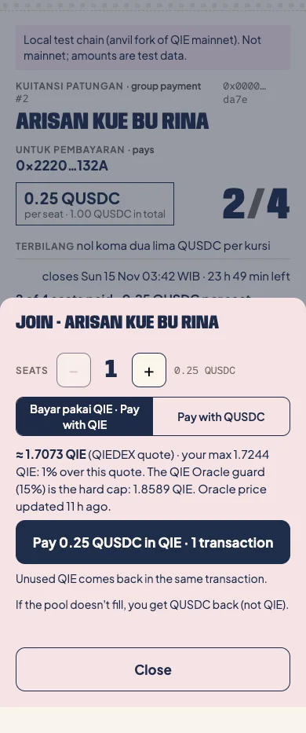
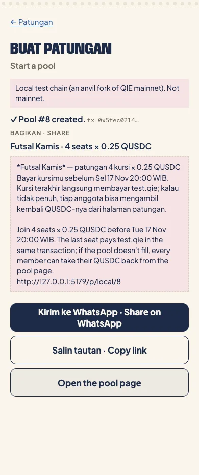
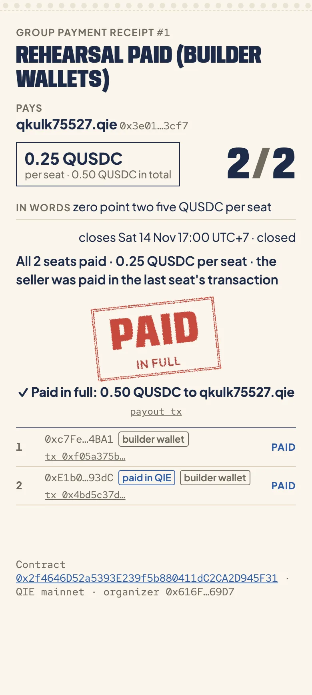
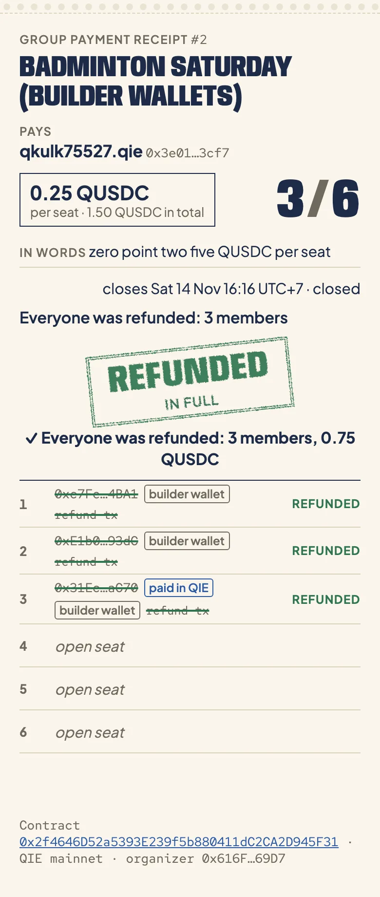
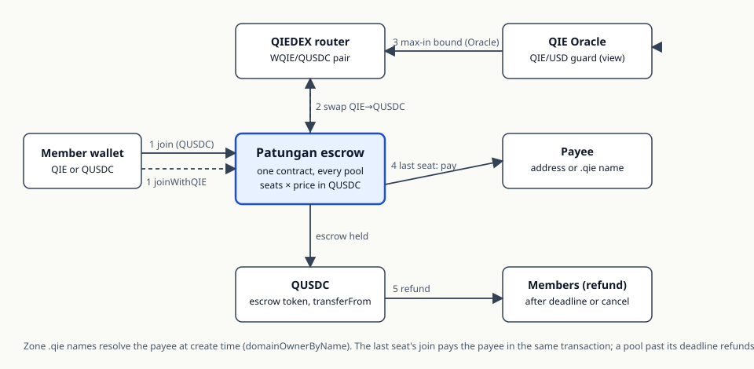

<div align="center">
  
  <h1>Patungan 🧾</h1>
  <p><em>Group payments with a deadline. Everyone chips in, or everyone gets their money back. Built for QIE mainnet.</em></p>
  

  <p><b>Live on QIE mainnet:</b> contract <a href="https://mainnet.qie.digital/address/0x2f4646D52a5393E239f5b880411dC2CA2D945F31#code"><code>0x2f4646D52a5393E239f5b880411dC2CA2D945F31</code></a>, source verified on Blockscout. One PAID and one REFUNDED pool ran on mainnet; in the PAID pool, swap + last seat + payout happened in one tx (<code>0x4bd5c37d…a7a0</code>, linked below). Reproduce: <code>forge test -vv</code> forks QIE mainnet through the public RPC, no keys.</p>

  <br/>

  [](https://patungan.edycu.dev)
  [](https://patungan.edycu.dev/judge)
  [](https://patungan.edycu.dev/pitch/)
  [](https://hackathon.qie.digital/)

  <br/>

  [](https://github.com/edycutjong/patungan/actions/workflows/ci.yml)
  [](https://github.com/edycutjong/patungan/releases/latest)
  [](https://mainnet.qie.digital/address/0x2f4646D52a5393E239f5b880411dC2CA2D945F31#code)
  
  
  
  
  
  
  [](LICENSE)

</div>

---

## 📸 See it in Action

| Join, paying in QIE | Share sheet | Paid in full | Refunded |
|---|---|---|---|
|  |  |  |  |

Live: [PAID pool](https://patungan.edycu.dev/p/mainnet-1/1) · [REFUNDED pool](https://patungan.edycu.dev/p/mainnet-1/2) · [/verify](https://patungan.edycu.dev/verify) · [/judge](https://patungan.edycu.dev/judge)

## 💡 The Problem & Solution

### The Problem

When a group buys something together (a football pitch, a concert block, a gift), one person fronts the money or collects it,
then chases everyone. If the group never fills, refunds depend on that one person.

### The Solution

1. An organizer opens a pool: seats × price in **QUSDC**, a deadline, and a payee (a `.qie` name or an address).
2. Members join paying QUSDC, or **QIE that the contract swaps to QUSDC through QIEDEX in the same transaction**.
3. The **last seat pays the payee in that same transaction** (the pool reads PAID).
4. If the deadline passes first, or the organizer cancels, **every member takes their QUSDC back**.

## 🏗️ Architecture & Tech Stack



| Layer | Tech |
|---|---|
| Contract | `src/Patungan.sol`, Solidity 0.8.28 (shanghai, QIE mainnet has no Cancun opcodes), Foundry |
| QIE components | QUSDC, QIEDEX router, Zone `.qie` names, QIE Oracle (table below) |
| Web app | Vite 8 + TypeScript + viem: landing `/`, pools `/pools`, pool page `/p/<deployment>/<id>`, `/new`, `/verify`, `/judge`, deck `/pitch/` |
| Hosting | Vercel, https://patungan.edycu.dev |

Dependencies: OpenZeppelin Contracts v5.7.0, forge-std v1.17.0, viem 2.x, Vite 8, TypeScript 7. Standard libraries used as dependencies, not forked code.

## 🏆 QIE Ecosystem Integration

All four are live on QIE mainnet (chain id 1990, explorer https://mainnet.qie.digital/) and Patungan's write paths are tested against their real state (forge fork tests and `script/local-flow.sh`).

| Component | Role in Patungan | Mainnet address |
|---|---|---|
| QUSDC | the escrow token (`transferFrom` in, transfer out) | `0x3F43DA82eC9A4f5285F10FaF1F26EcA7319E5DA5` |
| QIEDEX router (+ WQIE/QUSDC pair `0x73a3ccf7da7e473ed2e9994ae764f0e30f4e4dfe`) | swaps the member's QIE to QUSDC inside `joinWithQIE` | `0x08cd2e72e156D8563B4351eb4065C262A9f553Ef` |
| Zone `.qie` names | resolves the payee name (`domainOwnerByName`) | `0x9aab56e7727af53A3131985BFB16d845319b7bdc` |
| QIE Oracle (QIE/USDT feed, read as USD) | bounds what the swap may cost against the Oracle's fair value; `view` reads only | `0x3Bc617cF3A4Bb77003e4c556B87b13D556903D17` |

The QIEDEX router's source is not verified on the explorer; Patungan calls it through the standard V2 router interface and bounds the result with the Oracle.

## ⛓️ Live Deployment

No wallet needed to check anything: the pool pages, `/verify` and `/judge` are read-only calls. Only starting or joining a pool asks for a wallet.

> **Status: live on QIE mainnet.** Contract [`0x2f4646D52a5393E239f5b880411dC2CA2D945F31`](https://mainnet.qie.digital/address/0x2f4646D52a5393E239f5b880411dC2CA2D945F31#code) (chain 1990, source verified on Blockscout, deploy block 11,895,948).
> Two builder demo pools ran on mainnet: one PAID (last seat paid in QIE paid the payee in the same tx) and one REFUNDED (deadline passed,
> every member refunded). Tx hashes: [`DEMO.md`](DEMO.md) and [`evidence/mainnet-golive.md`](evidence/mainnet-golive.md).
> The last seat's full call trace (18 calls: Oracle read, QIEDEX swap, payout, change back) and a re-read of all 20 go-live txs:
> [`evidence/mainnet-trace.md`](evidence/mainnet-trace.md), regenerated by `python3 script/mainnet-trace.py` (read-only, public RPC, no keys).
> Live app: https://patungan.edycu.dev · fork and mock evidence: [`evidence/core-flow.md`](evidence/core-flow.md).

| Outcome | Pool | Tx hash |
|---|---|---|
| Deploy + verify | n/a | [`0x78090ff8afbdd9bce055a9ddbaaf8f6fa0b7d8e7486e673820746fa9a7d3c9ce`](https://mainnet.qie.digital/tx/0x78090ff8afbdd9bce055a9ddbaaf8f6fa0b7d8e7486e673820746fa9a7d3c9ce) |
| PAID (last seat pays the payee in one tx) | [1](https://patungan.edycu.dev/p/mainnet-1/1) | [`0x4bd5c37de92855d3993a88698543c9d7c51dccde97f0fcd8d484450cd359a7a0`](https://mainnet.qie.digital/tx/0x4bd5c37de92855d3993a88698543c9d7c51dccde97f0fcd8d484450cd359a7a0) |
| REFUNDED (deadline passed, members refunded) | [2](https://patungan.edycu.dev/p/mainnet-1/2) | [`0x7886eba210a403a13e808b236a02c53564684f25332bb7b2db67ebcc8cd69f0a`](https://mainnet.qie.digital/tx/0x7886eba210a403a13e808b236a02c53564684f25332bb7b2db67ebcc8cd69f0a) |

## 📊 Engineering Rigor

Numbers (all from [`evidence/`](evidence/)):

| What | Result | Source |
|---|---|---|
| Contract tests (`forge test`) | 74 passed: 50 on mocks (45 unit, 4 fuzz, 1 invariant suite of 3 properties); 24 read live mainnet state (8 Patungan fork, 16 day-one spike) | `evidence/forge-test-run.txt` |
| Contract coverage (`forge coverage`, `src/`) | 100% lines (166/166), statements (229/229), branches (37/37), functions (25/25) | CI Stage 1 |
| Web tests (`npm test`) | 210 passed | `evidence/web-test-run.txt` |
| Web coverage (`npm run test:coverage`, `web/src`) | 100% statements (1045/1045), branches (631/631), functions (183/183), lines (880/880) | CI Stage 1 |
| Mutation check | 5 of 5 injected bugs caught | `evidence/mutation-run.txt` |
| Last-seat `joinWithQIE` (swap + payout), fork | 267,557 gas | `evidence/local-flow-run.txt` |
| QIE join vs Oracle fair value, 12 joins on a fork | median +564 bps (guard 1,500 bps) | `evidence/bench.md` |
| Browser click-through | join, PAID, cancel and refund, deadline and refund, on a fork | `evidence/e2e-local-run.txt` |
| Last-seat `joinWithQIE` (swap + payout), **mainnet** | 267,557 gas, Success | `evidence/mainnet-golive.md` |
| Deploy, **mainnet** | 3,001,620 gas (0.0030 QIE at 1 gwei) | `evidence/mainnet-golive.md` |

QIE blocks take about 3.6 s (Blockscout `/api/v2/stats` average_block_time = 3616 ms on 2026-11-14).

### Attacks defeated

| Control | Why it is load-bearing | Test |
|---|---|---|
| Oracle-bounded swap | a QIEDEX quote past the Oracle fair value + 15% reverts, so a skewed pool cannot overcharge a member | `test/Patungan.t.sol:336` |
| Swap gets at most the ceiling | a router charging over its own quote cannot take more than the Oracle ceiling | `test/Patungan.t.sol:363` |
| Native spend re-checked after the swap | a router that drains more QIE than the ceiling reverts `PriceDeviation` | `test/Patungan.edges.t.sol:94` |
| Exact-out delivery check | a swap that delivers short reverts `SwapShort` | `test/Patungan.t.sol:371` |
| Reentrancy guard | a hostile router re-entering mid-swap hits the guard | `test/Patungan.t.sol:298` |
| Balance-delta accounting | a fee-on-transfer token reverts `TransferShort` instead of under-funding a seat | `test/Patungan.t.sol:198` |
| `.qie` owner snapshot | a name that resolves elsewhere than the form showed reverts `PayeeChanged` | `test/Patungan.t.sol:153` |
| Zero-owner name | a name that exists with no owner reverts `PayeeNotFound` | `test/Patungan.edges.t.sol:80` |
| Solvency gate | after an issuer burn, joins refuse while refunds stay open | `test/Patungan.t.sol:553` |
| Refund exactly once | `refundAll` skips members who already claimed | `test/Patungan.t.sol:472` |
| Conservation invariants | contract QUSDC balance == total held + donations; no native QIE sticks | `test/invariant/PatunganInvariant.t.sol:138` |

### Honest limits (4)

1. The only mainnet pools so far are the builder's two demo pools. Their member wallets are builder wallets, labelled as such in the app; they are not users. The PAID pool paid the builder's own name `qkulk75527.qie`, not a real seller.
2. Unless marked mainnet, the numbers above ran on a fork or mocks.
3. Distinct wallets are not distinct people. Any usage count we publish counts wallets.
4. QUSDC has an issuer-controlled `VAULT_ROLE`; if the issuer burns escrowed QUSDC, the pool cannot make everyone whole. Patungan refuses new joins while insolvent (`isSolvent()` exposes the check); it has no admin key of its own.

## 🚀 Getting Started

### Prerequisites

[Foundry](https://book.getfoundry.sh/getting-started/installation) and Node.js 22. No keys: the fork tests use the public QIE RPC.

### Installation

```sh
git submodule update --init --recursive
forge test -vv                    # forks QIE mainnet through the public RPC (override with QIE_RPC_URL)
cd web && npm ci && npm test && npm run build
```

Scripts that write to mainnet (`script/deploy-mainnet.sh`, `script/seed-demo.py`) need a deployer key and `CONFIRM=1`; see [`.env.example`](.env.example).

## 🧪 Testing & CI

```sh
forge test -vv                                   # contracts: unit, fuzz, invariants, mainnet fork
forge coverage --report summary --no-match-coverage '(script|test|lib)/' --no-match-path 'test/fork/*' --no-match-contract 'Spike|Fork'
cd web
npm run typecheck && npm run test:coverage       # web unit tests, 100% thresholds
npm run build && npm run budget                  # production build + bundle budget
npx playwright install chromium && npm run e2e   # Playwright against live QIE mainnet reads
```

[`ci.yml`](.github/workflows/ci.yml) runs six stages on every push and pull request:

| Stage | Jobs | Gate |
|---|---|---|
| 1 · Quality | contracts: `forge fmt --check`, `forge build --sizes`, `forge test` (incl. mainnet fork), coverage = 100%; web: `tsc`, vitest with 100% thresholds | blocking |
| 2 · Security | gitleaks over full history, Slither (`--fail-high`, triage in [`docs/security.md`](docs/security.md)), `npm audit --audit-level=high` | blocking |
| 3 · Build | `vite build` + bundle budget (JS ≤ 150 KB gzip, CSS ≤ 30 KB gzip) | blocking |
| 4 · E2E | 42 Playwright tests (21 specs × desktop + mobile Chrome): smoke, the PAID / REFUNDED pool flow, `/judge`, no horizontal scroll at 375 / 768 / 1440 px | blocking |
| 5 · Performance | Lighthouse CI on `/`, `/judge`, a pool page | advisory |
| 6 · Deploy gate | main only, needs stages 1-5; checks the production URLs return 200 and serve the mainnet deployment | blocking |

Alongside: [CodeQL](.github/workflows/codeql.yml) (JavaScript/TypeScript and GitHub Actions; CodeQL has no Solidity support, Slither covers the contract), [release](.github/workflows/release.yml) (semantic version tags from conventional commits), Dependabot, and GitHub secret scanning with push protection.

## 📁 Project Structure

- `src/Patungan.sol`: the escrow (one contract holds every pool). `src/interfaces/`: the QIE component interfaces.
- `test/`: unit tests on mocks, fuzz, invariants, `fork/` (live mainnet state), `spike/`, `mocks/`, `utils/`.
- `script/`: `deploy-mainnet.sh`, `seed-demo.py`, `local-flow.sh`, `bench.py`, `mutation-check.sh`, `e2e-local.py`, `e2e-create.py`, `export-abi.sh`, `fork-gas.sh`, `mainnet-probe.sh`.
- `web/`: the app (Vite + TypeScript + viem): pool page, `/new`, `/verify`, `/judge`; `web/e2e/` Playwright tests.
- `.github/workflows/`: `ci.yml` (6 stages), `codeql.yml`, `gitleaks.yml`, `release.yml`.
- `evidence/`: raw run outputs and their summaries.

## 📽️ Demo Materials

- Live app: https://patungan.edycu.dev · judge path: https://patungan.edycu.dev/judge ([`JUDGE.md`](JUDGE.md)) · pitch deck: https://patungan.edycu.dev/pitch/
- Reproduction and gas tables: [`DEMO.md`](DEMO.md)

## 📄 License

MIT, see [LICENSE](LICENSE).
